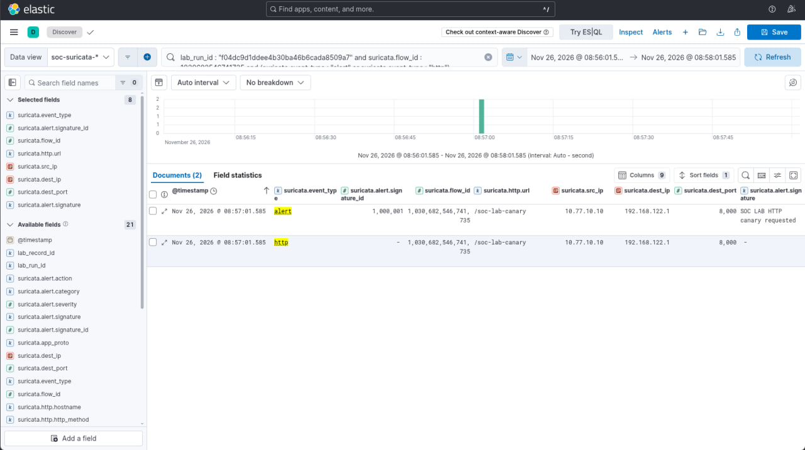
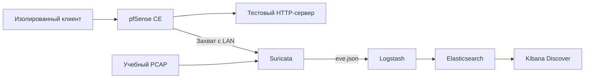

# Домашняя SOC-лаборатория

Стенд на одном ноутбуке с Debian 13 для проверки правил Suricata и разбора сетевых событий в Kibana. Один сценарий использует воспроизводимый учебный PCAP, второй — HTTP-трафик из изолированного клиента через pfSense CE.

## Результаты

| Прогон | Что получилось |
| --- | --- |
| Учебный PCAP | Все 22 правила Suricata сработали на ожидаемых потоках. Все 11 контрольных потоков прошли без неожиданных алертов. Elasticsearch проиндексировал 90 событий, включая 22 алерта. |
| Живой захват pfSense | Запросы к `/` и `/soc-lab-canary` вернули HTTP 200. Suricata обработала сохранённый PCAP с LAN pfSense. SID `1000001` сработал только на `/soc-lab-canary`. Elasticsearch проиндексировал 5 событий, включая один алерт. |



*Живой захват в Kibana Discover. У `alert` и `http` общий `flow_id` `1030682546741735`.*

## Архитектура

На Debian работают Suricata, тестовый HTTP-сервер и ELK в Docker Compose. Для живого сценария одна VM pfSense CE под KVM/libvirt маршрутизирует запросы из сетевого пространства имён Linux по виртуальным сетям стенда. Suricata анализирует захват с LAN pfSense. Logstash принимает `eve.json`, Elasticsearch индексирует события, Kibana Discover связывает алерт с HTTP-событием.



## 1. Проверить правила Suricata

На Debian установи `sudo apt install suricata python3 jq`. Из корня проекта выполни команду ниже.

```bash
./lab test
```

Команда генерирует синтетический PCAP на диске, запускает Suricata и сверяет алерты по SID и потоку. Генератор использует стандартную библиотеку Python. Каждый прогон сохраняет `fixture.pcap`, `eve.json` и `verification.json` в `runs/`. [Описание правил и ограничений](sensor/README.md)

## 2. Загрузить события в ELK

Нужен Docker Engine 28+ с плагином Compose. Проверь версию через `docker version`. Сервисы ELK публикуются на `127.0.0.1` и в стенде работают без аутентификации. [Установка Docker на Debian](https://docs.docker.com/engine/install/debian/) · [Настройка ELK](elk/README.md)

```bash
./lab up
./lab ingest runs/ПАПКА_ПРОГОНА/eve.json
```

Возьми путь к `eve.json` из вывода `./lab test`. Импорт дождётся индексации и выведет `run_id` и число событий.

В Kibana на `http://127.0.0.1:5601` создай Data View `soc-suricata-*` с полем времени `@timestamp`. В **Discover** выбери диапазон, включающий время импорта, и подставь свой `run_id` в фильтр.

```text
lab_run_id : "RUN_ID" and suricata.event_type : "alert"
```

Чтобы сопоставить алерт и HTTP-событие, замени условие по `suricata.event_type` на фильтр по `suricata.flow_id` из алерта. `@timestamp` показывает время импорта, `suricata.timestamp` — время пакета в захвате.

Команда `./lab down` останавливает ELK с сохранением тома Elasticsearch. [Диагностика и команды ELK](elk/README.md)

## 3. Разобрать трафик, захваченный pfSense

Отправь из изолированного клиента два запроса к тестовому серверу через pfSense. Проверь HTTP 200 для `/` и `/soc-lab-canary`. Скачай PCAP с LAN pfSense и укажи его путь в `./lab analyze`. [Настройка одной VM, клиента и захвата](docs/pfsense.md)

```bash
./lab analyze path/to/lan.pcap
./lab ingest runs/ПАПКА_ЗАХВАТА/eve.json
```

В Discover найди SID `1000001`, сопоставь его с HTTP-запросом `/soc-lab-canary` по `suricata.flow_id` и проверь отсутствие этого SID в потоке контрольного `/`.
